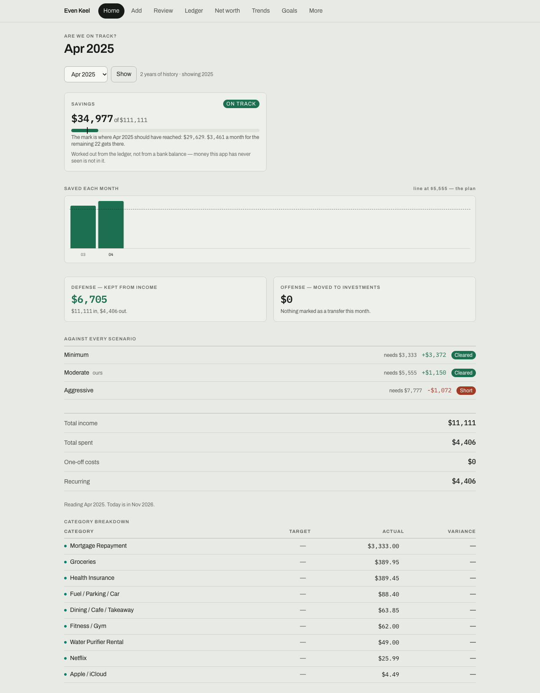
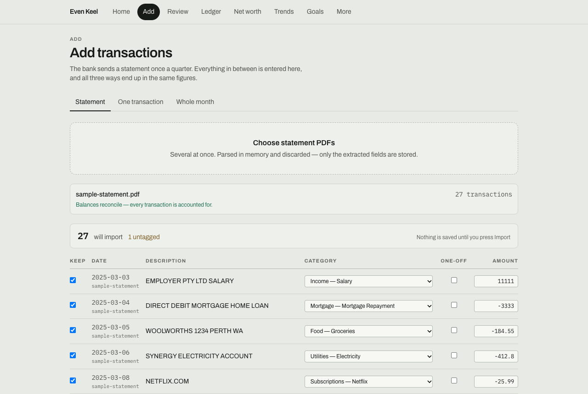
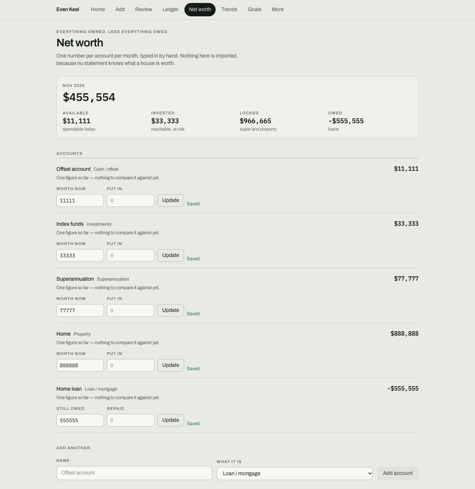
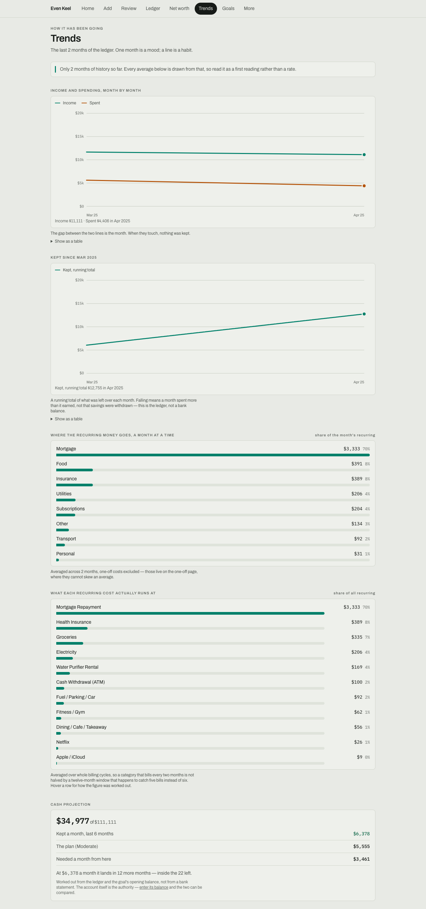
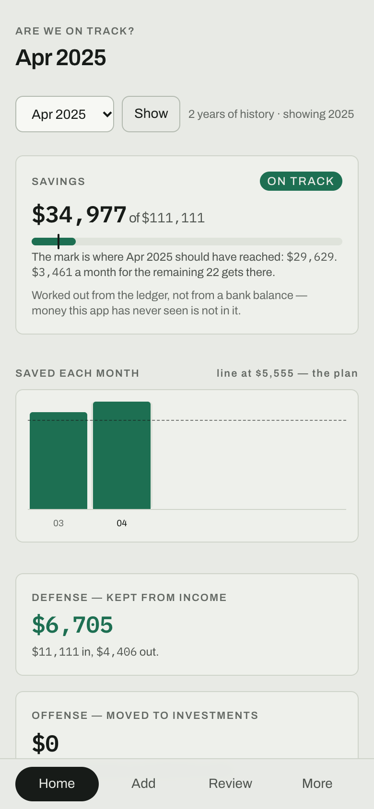

# Even Keel

**A full-stack practice project, still in progress.** I built it around a real problem of my own to work through database design, PDF parsing, authentication and deployment.

Even Keel is a household finance tracker for two people. It imports bank statement PDFs, categorises the transactions, scores each month against savings goals, and tracks net worth from balances entered by hand.



## What I practised

- **Database design.** Postgres schema with numbered migrations, database-level rules, and every table scoped to a household. A small database port runs the same SQL on Postgres and PGlite.
- **PDF parsing.** Rebuilds transactions from statement text and checks them against the statement's own printed balances.
- **Authentication.** Accounts in the database, scrypt password hashing, database-backed sign-in limits, session invalidation and single-use invites.
- **Security.** A per-request nonce Content-Security-Policy, security headers, origin checks and redaction of account numbers before storage.
- **Deployment and testing.** Vercel deployment through GitHub Actions, a build check for files the server needs at runtime, and unit, integration and end-to-end tests in CI.

## How this repo is built

- **Architecture focus.** Most of the design work is in the domain and data layers: statement parsing, money and date handling, and the database port.
- **UI placement.** Because this is a personal tool, page-specific UI stays close to its route and only shared pieces live in `src/components`.
- **If this were built for public use.** I would move to a shared component layer based on Atomic Design, with pages responsible only for composition.
- **Privacy in this copy.** Personal figures and names have been replaced with synthetic values, including in the commit history. Real statements are never committed.

## What it does

- **Import statements.** Reads PDFs in memory and shows every row for review before saving. Each statement is checked against its own printed balances.
- **Categorise.** Seed rules and remembered corrections tag transactions. Anything uncertain goes to a review queue.
- **Score the month.** Compares what was kept against three savings scenarios and tracks progress towards a goal.
- **Track net worth.** Separates what is available, invested, locked and owed.
- **Share by invitation.** There is no open sign-up. A partner can join the same household, or someone else can start a separate one.

## Screenshots

| Statement import                                                | Net worth                                          |
| --------------------------------------------------------------- | -------------------------------------------------- |
|  |  |

| Trends                                                          | Phone                                                         |
| --------------------------------------------------------------- | ------------------------------------------------------------- |
|  |  |

## Current status

| Area                                                         | Status             | Notes                                                        |
| ------------------------------------------------------------ | ------------------ | ------------------------------------------------------------ |
| Statement import, review queue, dashboard, net worth, trends | Working            | Tested locally with synthetic data                           |
| First account and both invite types                          | Working locally    | Tested on a local database                                   |
| Multi-user onboarding in production                          | Still being tested | Not yet tried with other people                              |
| Automatic categorisation                                     | In progress        | Seed rules still leave rows for review                       |
| Multi-currency                                               | Not built          | The schema is ready, but totals do not convert yet           |
| Splitting large UI files                                     | In progress        | `CategorySettings`, `ReviewQueue` and `ManualEntry` are next |

## Stack

Next.js, React, TypeScript, Tailwind CSS, Postgres (PGlite for local development), pdf.js, Vitest, Playwright, axe and GitHub Actions.

## Run it locally

There is no public demo because the deployed app holds private data. Locally, no database or account is needed. With `DATABASE_URL` unset, the app runs on PGlite.

```bash
nvm use
npm install
npm run dev
```

Open http://localhost:3000, create the first account, then import `test-fixtures/sample/sample-statement.pdf`.

To connect a hosted Postgres database, copy `.env.example` to `.env.local` and follow [docs/RUNBOOK.md](docs/RUNBOOK.md).

## Tests

251 unit and integration tests, with database tests running real SQL on PGlite. 27 Playwright end-to-end tests drive a production build, including accessibility checks with axe.

```bash
npm test
```

```bash
npx playwright install chromium
```

```bash
npm run e2e
```

CI runs formatting, lint, types, unit and integration tests, a production build and the end-to-end suite.

## Where to look

- **Statement parsing:** `src/lib/parse/`
- **Database port:** `src/lib/db/`
- **Dashboard composition:** `src/app/page.tsx` and `src/app/_dashboard/`
- **Shared components:** `src/components/`
- **Decisions and trade-offs:** [docs/DECISIONS.md](docs/DECISIONS.md)
- **Architecture:** [docs/ARCHITECTURE.md](docs/ARCHITECTURE.md)
